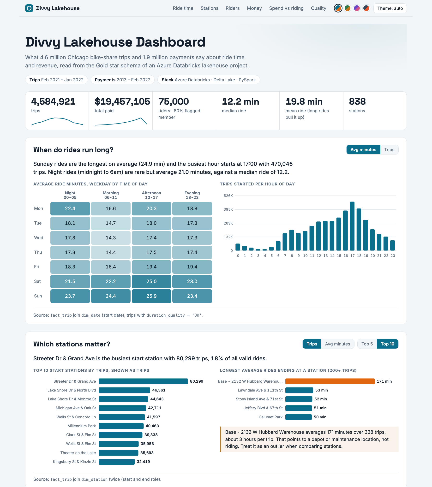
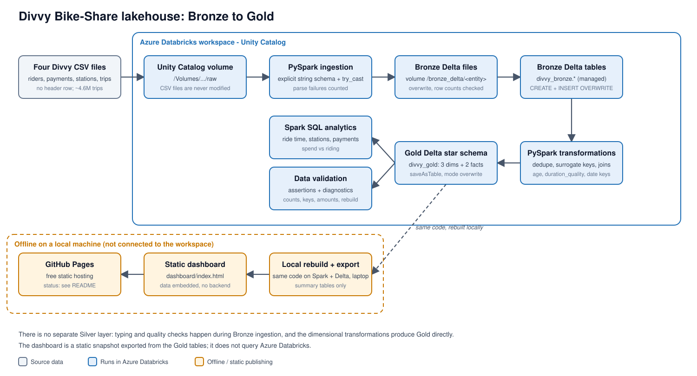
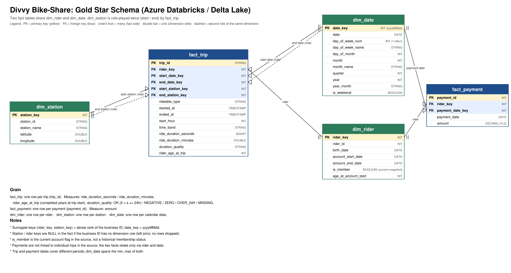

# Divvy Bike-Share | Azure Databricks Lakehouse & Analytics

[](https://learn.microsoft.com/azure/databricks/)
[](https://spark.apache.org/docs/latest/api/python/)
[](https://docs.delta.io/)
[](https://learn.microsoft.com/azure/databricks/data-governance/unity-catalog/)
[](https://spark.apache.org/sql/)
[](https://www.python.org/)

A Bronze-to-Gold data lakehouse for 4.6 million Chicago Divvy bike-share trips and 1.9 million rider payments, built with PySpark, Spark SQL and Delta Lake on Azure Databricks with Unity Catalog. It turns four headerless CSV files into a governed star schema, checks its own results, and answers business questions about ride time and revenue. A static dashboard presents the findings.

The project started from a Udacity Data Lakes brief with no starter code. The notebook, tests, validation and dashboard are my own work.

## Interactive dashboard

[](docs/images/dashboard-overview.png)

The dashboard shows ride time by weekday and time of day, busiest stations, rider age and membership, revenue by year and quarter, spend against riding, and a data-quality panel. It has a light and dark theme, four colour palettes and switchable chart views.

- **Live link:** not published yet. GitHub Pages is not enabled for this repository, so the URL `https://adebowalep.github.io/divvy-bikeshare-lakehouse-databricks/dashboard/` returns 404 at the time of writing. To publish it: Settings, Pages, deploy from branch `main`, folder `/ (root)`.
- **Run it now:** clone the repository and open [`dashboard/index.html`](dashboard/index.html) in a browser. All data is embedded. The only outside request is for two optional web fonts (Google Fonts); without them the page uses system fonts.
- **What it is not:** a live Databricks dashboard. It is a static snapshot. The Gold tables were rebuilt locally from the same code and summarised into [`dashboard/data.json`](dashboard/data.json), because the lab workspace is temporary.

Full-length captures: [light](docs/images/dashboard-overview.png), [dark](docs/images/dashboard-overview-dark.png).

## Key results

| Result | Value |
|---|---|
| Trips, source CSV = Bronze files = Bronze table = `fact_trip` | 4,584,921 |
| Payments, same chain to `fact_payment` | 1,946,607 |
| Riders, stations, calendar days | 75,000, 838, 3,288 |
| Payment total, CSV versus Gold | $19,457,105.25 on both sides |
| Valid trips (0 < duration ≤ 24 hours) | 4,583,447 |
| Flagged trips kept in the fact table | 116 negative, 81 zero, 1,277 over 24 hours |
| Local run of the corrected notebook, full data | 28 of 28 validation assertions, plus 1 diagnostic |
| Unit tests | 62 passed |

The Azure Databricks run recorded in [`evidence/`](evidence) is the first version of the notebook: 23 reported checks, of which 22 were assertions and one was a diagnostic. After that run I found two defects (trips over 24 hours counted as valid, and a leap-day age rule) and corrected them. The **corrected notebook has been run on the full data locally, not yet on Azure**. [`docs/validation.md`](docs/validation.md) keeps the two apart.

## Architecture



The pipeline is Bronze to Gold. There is no separate Silver layer, and [`docs/architecture.md`](docs/architecture.md) explains why.

1. **Source.** Four headerless CSV files sit in a Unity Catalog volume. The notebook never writes to them.
2. **Ingestion.** PySpark reads every column as a string with an explicit column list, then converts with `try_cast`. Any value that was present but failed conversion is counted and stops the run.
3. **Bronze.** Typed data is written as Delta files in the volume, then loaded into managed Delta tables with `CREATE TABLE` and `INSERT OVERWRITE`. Unity Catalog does not allow a table `LOCATION` inside a volume, which is why the tables are loaded from the files and do not point at them.
4. **Gold.** PySpark builds two facts and three dimensions and writes them with `saveAsTable` in overwrite mode.
5. **Use.** Spark SQL answers the business questions, and a validation table checks the result. A local rebuild of the same code feeds the dashboard.

## Dimensional model



| Table | One row per | Notes |
|---|---|---|
| `fact_trip` | trip | duration in seconds and minutes, `duration_quality`, rider age at trip |
| `fact_payment` | payment | `amount` as `DECIMAL(10,2)` |
| `dim_rider` | rider | age at account start, current `is_member` flag |
| `dim_station` | station | used twice by `fact_trip`, as start and end station |
| `dim_date` | calendar day | weekday, month, quarter, year |

Details, keys and limits: [`docs/data-model.md`](docs/data-model.md). Vector diagram: [`docs/Divvy_Star_Schema.pdf`](docs/Divvy_Star_Schema.pdf).

## Engineering decisions

- **Explicit schema, not inference.** The files have no header row, so column names come from the ERD. Station IDs turned out to be strings (`KA1503000012`), not integers as the ERD draws them.
- **Flag, don't delete.** A trip is `OK` only when `0 < duration ≤ 24 hours`. Negative, zero, over-24-hour and missing durations stay in `fact_trip` with a `duration_quality` value and are left out of averages. Row counts therefore always equal the source.
- **Left joins and NULL keys.** A missing station or rider shows up as a NULL key and is counted, never silently dropped.
- **Deterministic surrogate keys.** `row_number()` over the business ID gives the same keys for the same data. `date_key` is `yyyyMMdd`.
- **Overwrite everywhere.** Re-running replaces data and never appends. The second Gold build is compared by row counts and by a content hash of every column.
- **Age as completed years.** A 29 February birthday has its anniversary on 28 February in non-leap years.
- **No join between trips and payments.** The source links payments to riders only. The extra-credit analysis sums each to rider and month first.
- **Names and addresses stay out of Gold.** Bronze keeps the source columns.
- **One source of truth.** The transformation code lives in [`src/divvy_transforms.py`](src/divvy_transforms.py). The generator copies it into the notebook and the tests import it, so what is tested is what runs.

More detail and the reasoning: [`docs/implementation-notes.md`](docs/implementation-notes.md).

## Data quality and validation

The validation cell separates `ASSERT` rows, which can fail the run, from `INFO` rows, which only report. The local run of the corrected notebook on all 4.58 million trips passed 28 assertions: row-count lineage, key uniqueness, required keys, referential integrity, date coverage, duration-category rules, an independent valid-trip count, payment reconciliation, Delta format and a two-build rebuild comparison.

Two defects were found by comparing this project with a related one that analyses the same data, and were fixed in code with tests:

| Defect | Effect |
|---|---|
| Trips over 24 hours counted as valid | 1,277 trips pulled the mean ride up from 19.8 to 21.8 minutes and widened the member versus casual gap from 0.1 to 0.6 minutes |
| Leap-day birthday off by one | exactly one trip (a rider born on 29 February, riding on 28 February 2021) had its age wrong by a year |

The report lists which evidence is from Azure, which is local, and what is still unverified: [`docs/validation.md`](docs/validation.md).

## What the data says

All figures use valid trips unless stated.

- **Rides are short, with a long tail.** The median ride is 12.2 minutes and the mean is 19.8. Sunday is the longest day on average (24.9 minutes). The busiest hour starts at 17:00 with 470,046 trips.
- **One station dominates.** Streeter Dr & Grand Ave starts 80,299 trips, 1.8% of valid rides.
- **Members and casual riders ride alike.** Members average 19.9 minutes and casual riders 19.8, in every age band. Members make 80% of trips.
- **A depot looks like a station.** "Base - 2132 W Hubbard Warehouse" averages 171 minutes over 338 trips, far above the next station (53 minutes).
- **Revenue grew fast.** Payments total $19.46 million. 2021 brought in $6.08 million, 41% more than 2020.
- **Spending does not follow riding.** Average spend is $83 to $84 in every rides-per-month band, and 37,297 riders (50%) took no trips in the window yet still paid. That fits a synthetic payment table that is not linked to trips, so I report it as a property of the data and not as a business insight.

## Reproducibility

- **Tests, no Azure needed:** `pip install -r requirements-dev.txt`, then `pytest`.
- **Local run of the notebook:** `python tools/local_test.py notebooks/Divvy_Databricks_Lakehouse.ipynb <csv folder> <work folder>`.
- **On Azure Databricks:** upload the four CSV files to a Unity Catalog volume, import the notebook, set `CATALOG`, `VOLUME_SCHEMA` and `VOLUME` in the first cell, and run it on a single-node cluster (the recorded run used Runtime 15.4 LTS).

Prerequisites, cost, cleanup and troubleshooting: [`docs/reproduction.md`](docs/reproduction.md). The CSV files are not in this repository.

## Repository layout

```
notebooks/    Divvy_Databricks_Lakehouse.ipynb   corrected source notebook (no outputs yet)
src/          divvy_transforms.py                the tested transformation logic
tests/        62 tests: transformations, dashboard, notebook generator
dashboard/    index.html, data.json, template.html
docs/         architecture, data model, validation, implementation notes, reproduction, images
evidence/     executed Azure notebook (first version) and renders of its outputs
tools/        notebook and dashboard builders, local runner, diagram scripts
index.html    redirect to the dashboard for GitHub Pages
```

## Limitations and provenance

- **Temporary infrastructure.** The Udacity lab workspace is deleted when the session expires. This repository holds code and evidence, not a running environment.
- **Corrected version not run on Azure.** The recorded Azure run predates the duration and age corrections. Its saved outputs are kept unchanged, except for redacted rider names and addresses.
- **Source data.** The CSV files come with the Udacity project and are excluded from the repository. Trips are derived from public Divvy data. Riders and payments are synthetic. I did not verify the redistribution terms.
- **Scope.** Trips cover February 2021 to January 2022 and payments run from 2013 to 1 February 2022, so trip analytics and the spend comparison use only the overlap. `is_member` is a current flag with no history.
- **Interface screenshots.** I took 21 screenshots of the Azure and Databricks interfaces during the lab run, and they are not published because they show a temporary account name. [`evidence/README.md`](evidence/README.md) says exactly what is and is not included.

## Further documentation

[Architecture](docs/architecture.md) · [Data model](docs/data-model.md) · [Validation report](docs/validation.md) · [Implementation notes](docs/implementation-notes.md) · [Reproduction](docs/reproduction.md) · [Portfolio summary](docs/portfolio-summary.md) · [Evidence](evidence/README.md)

Related project on the same dataset, built with Azure Synapse and SQL: [divvy-azure-data-warehouse](https://github.com/adebowalep/divvy-azure-data-warehouse).

Released under the [MIT licence](LICENSE).
