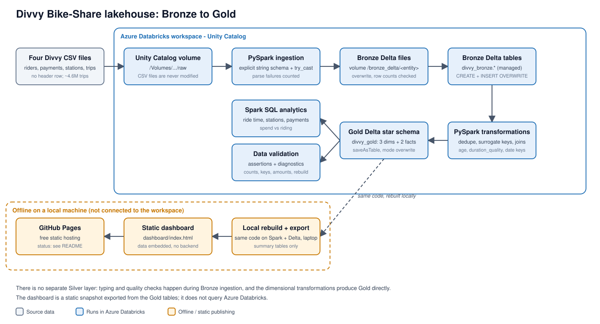

# Architecture

The editable source is [`architecture.drawio`](architecture.drawio). Both files are generated from one description by [`tools/draw_architecture.py`](../tools/draw_architecture.py).

## What runs where

| Stage | Where | What happens |
|---|---|---|
| Source | Unity Catalog volume `/Volumes/<catalog>/<schema>/<volume>/raw` | Four headerless CSV files (`riders`, `payments`, `stations`, `trips`). The notebook never writes to this folder. |
| Ingestion | Azure Databricks, PySpark | Each file is read as strings with an explicit column list, then converted with `try_cast`. A value that was present but became NULL is counted as a parse failure, and any failure stops the run. |
| Bronze files | Volume, `bronze_delta/<entity>` | Typed data written with `format("delta").mode("overwrite")`. The Delta transaction log is checked and counts are compared with the CSV. |
| Bronze tables | Unity Catalog, `divvy_bronze.*` | Managed Delta tables created with `CREATE TABLE` and filled with `INSERT OVERWRITE` from the Bronze files. |
| Transformations | Azure Databricks, PySpark | Deduplication, surrogate keys, joins, age and duration rules. The code is in [`src/divvy_transforms.py`](../src/divvy_transforms.py) and is embedded unchanged in the notebook. |
| Gold | Unity Catalog, `divvy_gold.*` | Three dimensions and two facts, written with `saveAsTable` in overwrite mode. |
| Analytics and validation | Azure Databricks, Spark SQL and PySpark | Eight business queries, and a validation table that separates assertions from diagnostics. |
| Dashboard | Local machine, then GitHub Pages | The Gold tables are rebuilt locally on Spark and Delta Lake with the same code, summarised to a small `data.json`, and embedded in a static HTML page. |

## Why Bronze tables are not external tables over the Bronze files

Unity Catalog does not allow a table `LOCATION` that sits inside a volume, because the paths would overlap. The Bronze Delta files in the volume therefore stay as files, and the registered Bronze tables are managed Delta tables loaded from them through temporary views. This costs one extra copy of the data. It keeps every object governed by Unity Catalog, and it removes any risk of two tables claiming the same storage path.

## Why there is no Silver layer

The project implements Bronze to Gold. Typing and quality checks happen during Bronze ingestion, and the dimensional transformations produce Gold directly. A persisted Silver layer would hold cleaned but not yet modelled data. Here the only cleaning is type conversion and deduplication, both of which are cheap and are re-run with every Gold build, so a Silver copy would add storage and one more thing to keep in step without adding information. If the source later needed real cleansing (address standardisation, late-arriving corrections, change capture), a Silver layer would become worthwhile.

## What the dashboard is, and is not

The dashboard is a static snapshot. It does not query Azure Databricks and has no backend. The lab workspace is temporary and is deleted when the session expires, so the dashboard data came from a local rebuild: the notebook's own cells were run on a local Spark and Delta Lake session against the same four CSV files, using [`tools/local_test.py`](../tools/local_test.py). [`tools/export_dashboard_data.py`](../tools/export_dashboard_data.py) then runs the section 8 aggregations on those tables and writes `dashboard/data.json`, and [`tools/build_dashboard.py`](../tools/build_dashboard.py) embeds that file in `dashboard/index.html`.
