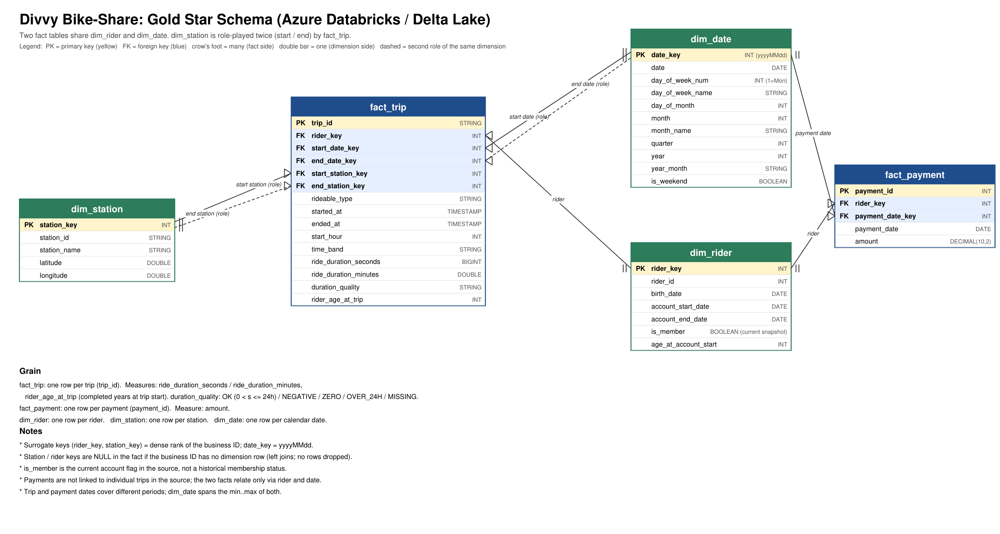

# Data model

A vector version is in [`Divvy_Star_Schema.pdf`](Divvy_Star_Schema.pdf). The model has two fact tables, because trips and payments are separate business events that the source does not link to each other, and three dimensions.

## Tables and grain

| Table | Grain (one row per) | Key | Main columns |
|---|---|---|---|
| `fact_trip` | trip | `trip_id` | `rider_key`, `start_date_key`, `end_date_key`, `start_station_key`, `end_station_key`, `rideable_type`, `started_at`, `ended_at`, `start_hour`, `time_band`, `ride_duration_seconds`, `ride_duration_minutes`, `duration_quality`, `rider_age_at_trip` |
| `fact_payment` | payment | `payment_id` | `rider_key`, `payment_date_key`, `payment_date`, `amount` (`DECIMAL(10,2)`) |
| `dim_rider` | rider | `rider_key` (business key `rider_id`) | `birth_date`, `account_start_date`, `account_end_date`, `is_member`, `age_at_account_start` |
| `dim_station` | station | `station_key` (business key `station_id`) | `station_name`, `latitude`, `longitude` |
| `dim_date` | calendar day | `date_key` | `date`, `day_of_week_num`, `day_of_week_name`, `day_of_month`, `month`, `month_name`, `quarter`, `year`, `year_month`, `is_weekend` |

`dim_station` is role-played: `fact_trip` joins to it twice, once as the start station and once as the end station. `dim_date` is joined on the trip start date for ride-time analysis and on the payment date for revenue.

## Keys

- `rider_key` and `station_key` are surrogate keys made with `row_number()` ordered by the business ID. They are deterministic: the same source data always yields the same keys. They are not stable if rows are added, because a new ID shifts every key after it. That is acceptable for a full overwrite build and would not be for an incremental load.
- `date_key` is the date written as `yyyyMMdd`, an integer that sorts correctly and needs no lookup to read.
- Station IDs are strings (for example `KA1503000012`), although the course ERD draws them as integers.

## Referential integrity

Delta tables do not enforce foreign keys, so the notebook checks them. The facts are built with left joins to the dimensions, so an unmatched station or rider would appear as a NULL key and be counted, never silently dropped. `fact_trip` keeps one row per source trip, which the validation proves by comparing counts and key uniqueness.

## Duration quality

`ride_duration_seconds` is the difference between `ended_at` and `started_at`. `duration_quality` classifies it:

| Value | Rule | Used in duration averages |
|---|---|---|
| `OK` | `0 < seconds <= 86400` | yes |
| `NEGATIVE` | `seconds < 0` | no |
| `ZERO` | `seconds = 0` | no |
| `OVER_24H` | `seconds > 86400` | no |
| `MISSING` | start or end time is NULL | no |

Flagged trips stay in `fact_trip`, so the row count still equals the source and every flagged trip can be investigated. The 24 hour limit is the same rule the related [Synapse warehouse](https://github.com/adebowalep/divvy-azure-data-warehouse) uses for the same dataset. Timestamps are used as stored, with no timezone conversion.

## Age

Age is completed years at the event date: the year difference, minus one if the anniversary has not yet happened. A 29 February birthday has its anniversary on 28 February in non-leap years, which matches T-SQL `DATEADD` and the Synapse warehouse. The function returns NULL when either date is missing or the event is before birth. `rider_age_at_trip` uses the trip start date and `age_at_account_start` uses the account start date.

## Limitations

- `is_member` is the rider's current flag. The source has no membership history, so member versus casual results describe today's status.
- Payments link to riders, not to trips, so spend cannot be compared per ride. The extra-credit analysis therefore compares riders over the 12-month trip window.
- Names and addresses are left out of Gold. `dim_rider` keeps `birth_date`, which the age calculation needs. The riders are synthetic.
